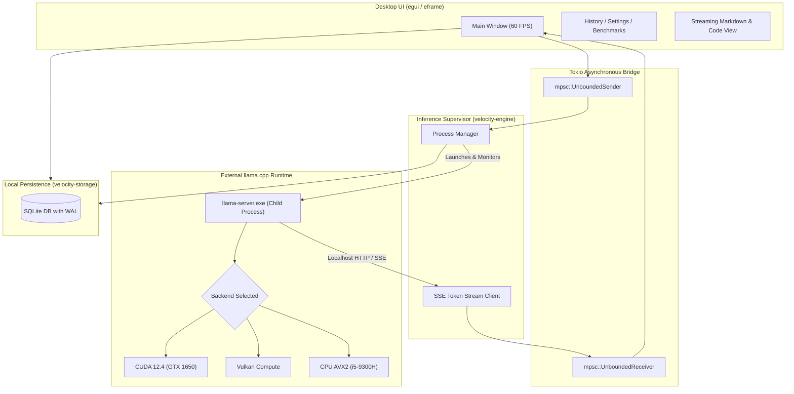

# VELOCITY AI — System Architecture & Design Specification

**Author:** VELOCITY AI Systems Team  
**Target:** High-performance, low-latency, fully offline desktop AI application on Windows 11 & Linux.  
**Guiding Principle:** Every engineering decision must make VELOCITY AI faster, lighter, or more resource-efficient.

---

## 1. Modular Rust Workspace Layout

```
VELOCITY-AI/
├── apps/
│   └── desktop/                  # egui/eframe native desktop application
│
├── crates/
│   ├── velocity-core/            # Shared errors (thiserror/anyhow), domain types, tracing
│   ├── velocity-hardware/        # Hardware audit, CPU features, RAM, VRAM, backend detection
│   ├── velocity-config/          # Persistent user settings, directory resolution, paths
│   ├── velocity-storage/         # SQLite chat history, message persistence, benchmark database
│   ├── velocity-models/          # GGUF header inspection, catalog management, resumable downloader
│   ├── velocity-engine/          # External llama-server supervisor, HTTP SSE client, backend trait
│   └── velocity-benchmark/       # Benchmark runner, multi-trial statistics, metrics recorder
│
├── models/                       # Default local GGUF storage (configurable)
├── benchmarks/
│   └── results/                  # Structured JSON and Markdown benchmark reports
├── scripts/                      # Build, packaging, and setup helper scripts
├── docs/                         # Technical specifications, hardware reports, plans
├── tests/                        # Integration and end-to-end tests
├── Cargo.toml                    # Workspace root manifest
├── PHASE_TRACKER.md              # Milestone progression tracker
├── README.md                     # Project documentation
└── LICENSE                       # MIT License
```

---

## 2. Component Responsibilities & Boundaries

### `velocity-core`
- Defines core data models: `Message`, `Role`, `Conversation`, `ModelInfo`, `InferenceMetrics`.
- Standardizes project errors using `thiserror`.
- Configures centralized logging and structured tracing with `tracing-subscriber`.

### `velocity-hardware`
- Probes CPU via `raw-cpuid` or Windows CIM: core counts, logical threads, AVX/AVX2/FMA flags.
- Probes GPU via NVML / Windows DXGI / Vulkan loader: model name, total VRAM, free VRAM, driver version.
- Recommends optimal execution backends (`Cpu`, `Vulkan`, `Cuda`) and GPU layer offload counts (`-ngl`).

### `velocity-config`
- Resolves system paths: `%LOCALAPPDATA%/VelocityAI/models/`, `%LOCALAPPDATA%/VelocityAI/config.toml`.
- Serializes and deserializes application preferences with `serde` and `toml`.

### `velocity-storage`
- Embedded SQLite engine via `rusqlite` with WAL (Write-Ahead Logging) enabled.
- Fully offline, thread-safe access through connection pooling or actor channel.
- Tables:
  - `conversations (id, title, created_at, updated_at, model_id)`
  - `messages (id, conversation_id, role, content, tokens_per_sec, ttft_ms, timestamp)`
  - `benchmark_runs (id, timestamp, backend, model, threads, ctx_size, tok_per_sec, ttft_ms, peak_ram_mb, peak_vram_mb)`

### `velocity-models`
- Fast GGUF header parser (reading tensor count, architecture, context length, quantization format without loading full weights into memory).
- Local model discovery from configured directories.
- Resumable HTTP model downloader supporting `Range` headers, SHA256 integrity verification, and real-time progress callbacks.

### `velocity-engine`
- Defines the `InferenceBackend` trait:
  ```rust
  #[async_trait::async_trait]
  pub trait InferenceBackend: Send + Sync {
      async fn start(&mut self, config: &InferenceConfig) -> Result<(), EngineError>;
      async fn stop(&mut self) -> Result<(), EngineError>;
      async fn is_ready(&self) -> bool;
      async fn stream_completion(
          &self,
          prompt: CompletionRequest,
      ) -> Result<BoxStream<'static, Result<StreamChunk, EngineError>>, EngineError>;
      fn backend_type(&self) -> BackendType;
  }
  ```
- Implements `LlamaCppProcessBackend`:
  - Supervises `llama-server.exe` as a managed child process.
  - Dynamically assigns an available localhost port.
  - Monitors `/health` endpoint until model loading completes.
  - Streams completion tokens via Server-Sent Events (SSE) `/v1/chat/completions`.
  - Captures generation metrics (eval count, eval duration, tokens/sec, time-to-first-token).
  - Automatically captures process crashes, stderr logs, and restarts runtime on demand.

### `velocity-benchmark`
- Runs structured inference benchmarks across parameter grids (backends, thread counts, quantizations, context sizes).
- Performs warm-up runs followed by at least 3 trials, recording median, mean, and variance.
- Outputs `benchmarks/results/latest.json` and human-readable `benchmarks/results/latest.md`.

### `apps/desktop`
- Modern, lightweight desktop interface built with `egui` and `eframe`.
- 100% decoupled from inference execution: communicates with `velocity-engine` solely through asynchronous message channels (`tokio::sync::mpsc`).
- UI thread runs at a locked 60 FPS without ever blocking on disk I/O or network/socket requests.

---

## 3. Process Supervision & Data Flow Architecture



---

## 4. Fault Isolation & Crash Recovery Contract

1. **Process Independence:** The Rust UI and inference process execute in completely separate memory spaces. A segmentation fault or CUDA out-of-memory error inside `llama-server` cannot corrupt or crash the UI.
2. **Process Health Monitoring:** The supervisor periodically polls the child process. If the process terminates unexpectedly, `velocity-engine` traps the exit code, reads the captured stderr log, and notifies the UI with a descriptive diagnostic message instead of an unhandled panic.
3. **Safe Shutdown Guarantee:** When the user closes the application, the supervisor sends a graceful shutdown signal (`SIGTERM` on Linux, `CTRL_BREAK` / Process kill on Windows) ensuring no orphaned `llama-server.exe` processes linger in Task Manager.
4. **Offline Isolation:** All network requests are strictly bound to `127.0.0.1`. No outbound telemetry, analytics, or remote API calls are made.

